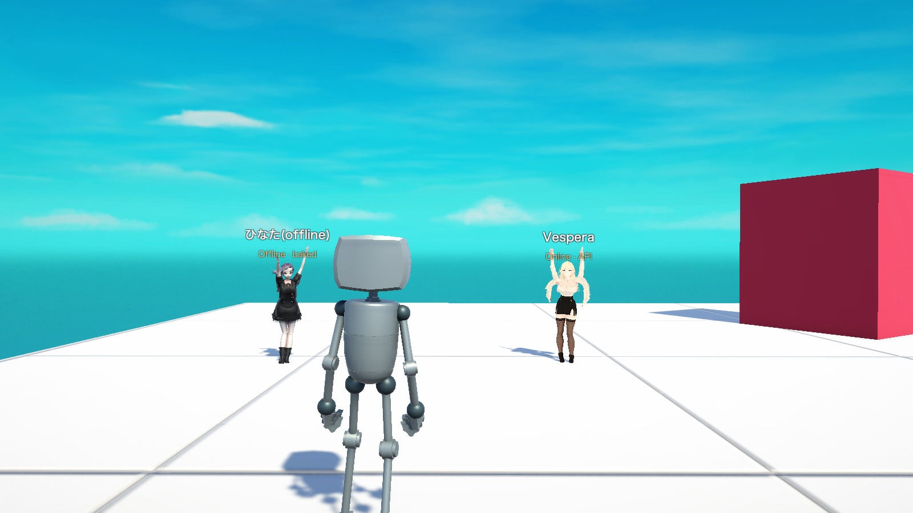
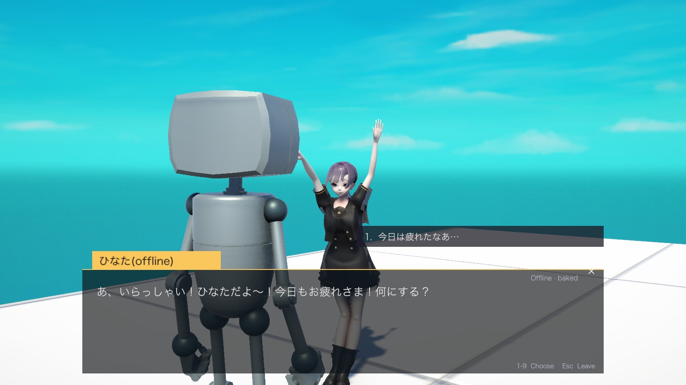
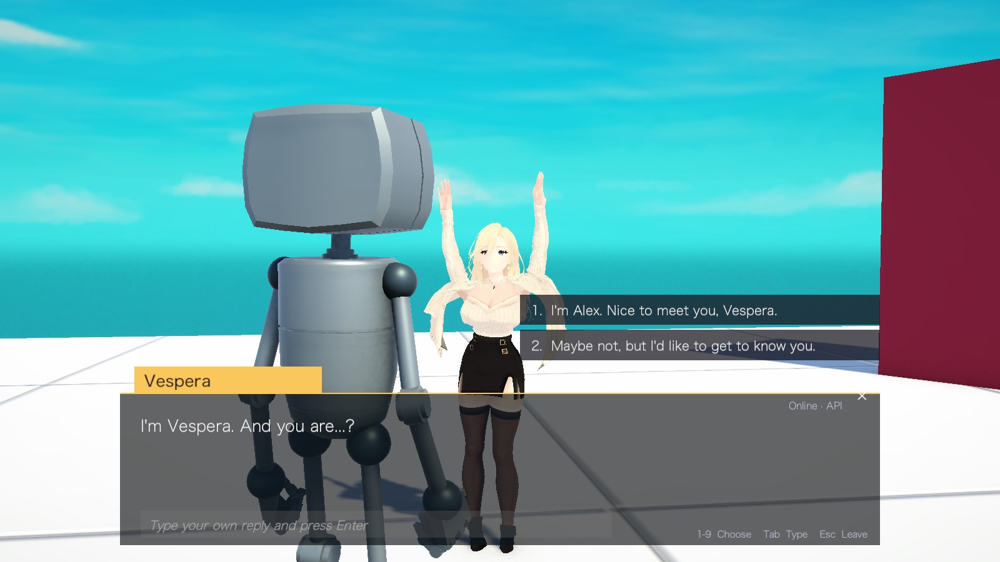

# Npcify Unity example

A small third-person game made with Unity 6. Two AI characters made with
[Npcify](https://npcify.ai) stand in the level:

| NPC | Mode | Where the replies come from |
| --- | --- | --- |
| **ひなた (offline)** | Offline, baked | A baked conversation that ships with the game (`.npcp` file). No network. |
| **Vespera** | Online | The Npcify API generates each reply, voice and animation at run time. |

Walk to an NPC, press **E** and talk. The dialogue box works like a classic RPG:
typewriter text with voice and lip-sync, numbered reply choices, and (for the
online NPC) a free-text reply.



| Offline NPC | Online NPC |
| --- | --- |
|  |  |

## Requirements

- Unity **6000.2.9f1** (Unity 6.2). Other Unity 6 versions probably work.
- macOS or Windows.
- An internet connection when you open the project for the first time
  (Unity downloads UniVRM from GitHub) and for the online NPC.

## Start

1. Clone the repository.
2. Copy `.env.example` to `.env` and set `NPCIFY_API_KEY` to your Npcify API key.
   Create the key in the Npcify dashboard (**Settings > API keys**) and give it
   access to both characters. The offline NPC works without a key.
3. Open the project folder in Unity Hub. The scene
   `Assets/NpcifyDemo/Scenes/NpcifyDemo.unity` opens.
4. Press **Play**.

The `.env` file is in `.gitignore`. Do not commit your key.

## Controls

| Action | Keyboard and mouse |
| --- | --- |
| Move, look, sprint, jump | WASD, mouse, Shift, Space (a gamepad also works) |
| Talk to the nearby NPC | **E**, left click, or the west button of a gamepad |
| Choose a reply | **1**–**9** or click |
| Skip the current line | Space or click the dialogue box |
| Type your own reply (online NPC) | Tab, then Enter |
| Leave the conversation | Esc or **×** |

## How it works

| Part | File |
| --- | --- |
| Player | The Starter Assets third-person character (`PlayerRobot`) of Unity's *Get Started* template, with an over-the-shoulder Cinemachine camera |
| Settings from `.env` | `Assets/NpcifyDemo/Scripts/DemoEnv.cs` |
| NPC: loads the VRM model with UniVRM, plays VRMA animations, adds `NpcifyCharacter` | `Assets/NpcifyDemo/Scripts/NpcifyNpc.cs`, `NpcVrmaPlayer.cs` |
| Model, animations and conversation sources (offline folder or API) | `Assets/NpcifyDemo/Scripts/NpcCharacterSource.cs` |
| Interaction prompt, conversation flow and input | `Assets/NpcifyDemo/Scripts/NpcDialogueController.cs` |
| RPG dialogue UI (built in code) | `Assets/NpcifyDemo/Scripts/DialogueView.cs` |
| Over-the-shoulder conversation camera | `Assets/NpcifyDemo/Scripts/DialogueCameraRig.cs` |

`NpcifyCharacter` from the Npcify Unity SDK does the character work: it plays
each staging (speech audio, lip-sync visemes, expressions, animation cues,
typewriter text) and writes the face blend shapes of the VRM model.

- **Offline NPC.** The game reads `Assets/StreamingAssets/Npcify/hinata/`:
  the VRM model, its VRMA animations and the baked conversation
  (`conversation.npcp`). `NpcifyCharacter.AttachBakedConversation()` loads the
  conversation; every choice plays the recorded reply from memory.
- **Online NPC.** The game downloads the VRM model and the animations through
  the API, then `CreateConversationAsync()` and `ReplyAsync()` request each
  reply from the API.

The Npcify Unity SDK is in `Packages/ai.npcify.sdk` (version 0.2.0).

## Use your own characters

1. Change the character IDs in `.env`:
   - `NPCIFY_ONLINE_CHARACTER_ID`: any character that your key can access.
   - `NPCIFY_OFFLINE_CHARACTER_ID`: a character with **Enable baked conversation**
     turned on (dashboard: character editor, **Baking** tab).
2. Run **Npcify > Download Offline Character** in the Unity menu. It replaces
   the files in `Assets/StreamingAssets/Npcify/hinata/`.

## Builds

**Npcify > Build > macOS** or **Windows** makes a player in `Builds/`. The build
script copies your `.env` next to the game, so the online NPC works in the
build. Do not share a build that contains your key; give each player their own
key or call the API from your own server.

## Smoke test

The game has a scripted test that walks to each NPC, talks for two turns,
saves screenshots and quits with exit code 0 when everything worked:

```bash
"Builds/macOS/NpcifyUnityDemo.app/Contents/MacOS/Npcify Unity Demo" -npcifyAutotest /tmp/npcify-shots -logFile /tmp/npcify.log
```

## Licenses

- The demo code (`Assets/NpcifyDemo`) is MIT licensed, see [LICENSE](LICENSE).
- The level, the player character and the other assets from Unity's
  *Get Started* template (`Assets/SourceFiles`, `Assets/Prefabs`, `Assets/Materials`,
  `Assets/Scenes`, …) are under the
  [Unity Companion License](https://unity.com/legal/licenses/unity-companion-license).
- [UniVRM](https://github.com/vrm-c/UniVRM) is MIT licensed.
- The two characters (models, voices, conversation) belong to Npcify and are
  included for this demo only.
